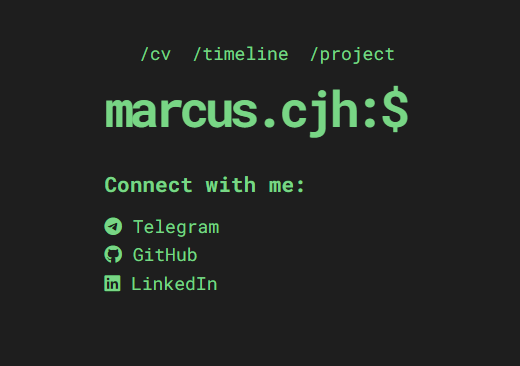

# Marcus Chan - Portfolio

A modern, responsive portfolio website built with TypeScript, Vite, and modern web technologies. Features interactive animations, responsive design, and automated CI/CD deployment.



## 🚀 Quick Start

```bash
# Install dependencies
npm install

# Start development server
npm run dev

# Run tests (watch mode)
npm run test

# Run tests once, as CI does
npm run test:run

# Build for production
npm run build
```

Deployment to GitHub Pages happens automatically via GitHub Actions on push to `master`/`main`.

## 📁 Project Structure

```
├── src/
│   ├── main.ts               # Composition root: boots each feature in order
│   ├── features/             # One folder per feature (nav, timeline, showcase,
│   │                         #   modal, hero, socials, footer, …)
│   ├── components/           # Reusable widgets (TypedText, DragRail)
│   ├── services/             # Data, loading and SEO services
│   ├── lib/                  # DOM helpers, constants, inline SVG icons,
│   │                         #   auto-escaping markup template tag
│   ├── styles/               # Cascade-layered CSS: one entry file + partials
│   └── test/setup.ts         # Shared Vitest setup
├── plugins/                  # Build-time Vite plugins: sitemap, web manifest,
│                             #   JSON-LD, prerendered per-project pages
├── public/data.json          # Site content & configuration
└── .github/workflows/        # CI/CD automation
```

Unit tests are co-located as `*.test.ts` next to the code they cover.

## 🎨 Customization

Edit `public/data.json` to update:
- Personal information
- Project showcase
- Timeline entries
- Social media links

## 🛠️ Tech Stack

- **TypeScript** - Type-safe development
- **Vite** - Fast build tool & dev server
- **Vitest** - Modern testing framework
- **ESLint + Prettier** - Code quality & formatting
- **CSS3** - Cascade layers, container queries, `color-mix()`, scroll-driven animation
- **GitHub Actions** - Automated CI/CD


---

**Marcus Chan** - [GitHub](https://github.com/MarcusCJH) | [LinkedIn](https://www.linkedin.com/in/marcuschanjh) | [Portfolio](https://marcuscjh.github.io)